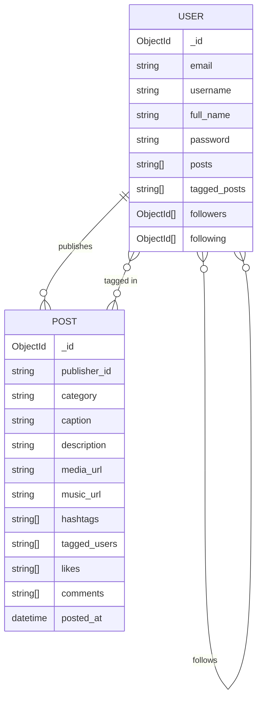

# InstaClone Backend

A RESTful API for a social media platform with user authentication, follow graphs, and post creation — built with FastAPI and MongoDB.

---

## Tech Stack

| Layer | Technology |
|---|---|
| Framework | FastAPI 0.115 |
| Runtime | Python 3 / Uvicorn |
| Database | MongoDB (Motor — async driver) |
| Auth | PyJWT + bcrypt |
| Validation | Pydantic v2 |
| Testing | pytest + pytest-asyncio + mongomock |
| API Docs | Swagger UI / ReDoc (built-in) |

---

## Key Features

- **JWT authentication** — register and login return a signed token; all protected routes verify it via a FastAPI `Depends` guard
- **bcrypt password hashing** — passwords are never stored or returned in plaintext; the `password` field is stripped from every response
- **Social graph** — follow/unfollow by username or user ID, with atomic `$addToSet` / `$pull` writes to both sides of the relationship
- **Post creation with tagging** — posts resolve tagged usernames to IDs at write time and update each tagged user's `tagged_posts` list
- **Categorised content** — posts are assigned to one of seven categories (Tech, Entertainment, Business, Sports, Music, Art, Education) enforced by an enum
- **Layered validation** — Pydantic validates types at the boundary; custom validators enforce business rules (password complexity, username format, caption/hashtag length, URL scheme)

---

## Architecture

```
instaclone-backend/
├── app/
│   ├── main.py                # FastAPI app, router registration, custom OpenAPI schema
│   ├── config/
│   │   └── settings.py        # Reads env vars (MONGO_URI, JWT_SECRET_KEY, JWT_ALGORITHM)
│   ├── models/
│   │   ├── db.py              # Plain-class document models (UserDB, PostDB, CommentDB) + ObjectId serializer
│   │   └── pydantic.py        # Request body schemas (UserCreateRequest, PostCreateRequest, …)
│   ├── routes/
│   │   ├── auth_routes.py     # POST /auth/create, /auth/login, /auth/verify-token
│   │   ├── user_routes.py     # GET/PUT profile, follow/unfollow, followers/following
│   │   └── post_routes.py     # POST /posts/
│   ├── services/
│   │   ├── auth_service.py    # create_user, authenticate_user
│   │   ├── user_service.py    # CRUD + follow graph mutations
│   │   └── post_service.py    # create_post (inserts post, updates publisher + tagged users)
│   └── utils/
│       ├── auth.py            # create_access_token, verify_token, get_current_user (Depends)
│       ├── db.py              # get_database() — returns Motor async client
│       ├── user_validator.py  # validate_email, validate_password, validate_username
│       └── post_validator.py  # validate_caption, validate_hashtags, validate_media_url, …
├── requirements.txt
├── .env.example
└── README.md
```

### Request flow

```
HTTP request
  → FastAPI router (routes/)
    → Input validation (Pydantic model + custom validator utils)
      → Auth guard: get_current_user Depends (utils/auth.py)
        → Service layer (services/)
          → Motor async query (utils/db.py → MongoDB)
            → Serialize ObjectIds (models/db.py serialize_document)
              → JSON response
```

---

## Design Decisions

- **JWT with per-token salt** — `create_access_token` mixes a random 60-byte salt into each token payload. This means two logins with identical data produce different tokens, preventing simple replay, though tokens cannot be individually revoked (no blocklist).
- **bcrypt for password storage** — passwords are hashed with `bcrypt.gensalt()` at registration. The raw password is never persisted or returned; routes that return user documents call `user.pop("password")` before sending the response.
- **Motor for async I/O** — FastAPI is async-native; Motor provides non-blocking MongoDB calls that fit naturally into `async def` route handlers without thread-pool overhead.
- **Two-layer validation** — Pydantic handles type coercion and `EmailStr` format checks at the HTTP boundary; a separate `utils/validators` layer enforces domain rules (password complexity, username character set, max hashtag count) so business logic stays out of Pydantic models.

---

## API Reference

### Auth

| Method | Endpoint | Auth | Description |
|---|---|---|---|
| POST | `/auth/create` | No | Register a new user; returns user info + access token |
| POST | `/auth/login` | No | Authenticate with email + password; returns access token |
| POST | `/auth/verify-token` | No | Validate a JWT; returns user_id on success |

### Users

| Method | Endpoint | Auth | Description |
|---|---|---|---|
| GET | `/users/get-by-email` | No | Look up a user by email address |
| GET | `/users/profile/{username}` | No | Get public profile by username |
| PUT | `/users/profile/update` | Bearer | Update own profile fields (partial update) |
| POST | `/users/follow/` | Bearer | Follow a user by `target_user_id` query param |
| POST | `/users/follow/{username}` | Bearer | Follow a user by username |
| POST | `/users/unfollow/` | Bearer | Unfollow a user by `target_user_id` query param |
| POST | `/users/unfollow/{username}` | Bearer | Unfollow a user by username |
| GET | `/users/{user_id}/followers` | Bearer | List current user's followers |
| GET | `/users/{user_id}/following` | Bearer | List users the current user follows |

### Posts

| Method | Endpoint | Auth | Description |
|---|---|---|---|
| POST | `/posts/` | Bearer | Create a new post (resolves tagged usernames to IDs) |

---

## Data Model

### Collections

**`users`**

| Field | Type | Notes |
|---|---|---|
| `_id` | ObjectId | MongoDB primary key |
| `email` | string | unique |
| `username` | string | unique, 3–30 chars, `[A-Za-z0-9_-]` |
| `full_name` | string | max 100 chars |
| `password` | string | bcrypt hash |
| `posts` | string[] | post IDs published by this user |
| `tagged_posts` | string[] | post IDs where this user is tagged |
| `followers` | ObjectId[] | users following this user |
| `following` | ObjectId[] | users this user follows |

**`posts`**

| Field | Type | Notes |
|---|---|---|
| `_id` | ObjectId | MongoDB primary key |
| `publisher_id` | string | `_id` of the creating user |
| `category` | enum | Tech \| Entertainment \| Business \| Sports \| Music \| Art \| Education |
| `caption` | string | max 100 chars |
| `description` | string | max 500 chars |
| `media_url` | string | must start with `http://` or `https://` |
| `music_url` | string? | optional, same URL scheme constraint |
| `hashtags` | string[] | max 10 tags, each max 20 chars |
| `tagged_users` | string[] | resolved from usernames to user `_id`s |
| `likes` | string[] | user IDs (populated by future endpoint) |
| `comments` | string[] | comment records (populated by future endpoint) |
| `posted_at` | datetime | set server-side at creation |

### Entity Relationships



---

## Getting Started

### Prerequisites

- Python 3.10+
- A MongoDB Atlas cluster (or local MongoDB instance)

### Install

```sh
git clone https://github.com/yourusername/instaclone-backend.git
cd instaclone-backend
python3 -m venv env
source env/bin/activate      # Windows: env\Scripts\activate
pip install -r requirements.txt
```

### Configure environment

```sh
cp .env.example .env
# Edit .env — fill in MONGO_URI, JWT_SECRET_KEY, JWT_ALGORITHM
```

See `.env.example` for the required variables. No migrations are needed; MongoDB creates collections on first write.

### Run

```sh
uvicorn app.main:app --reload
```

The API is available at `http://127.0.0.1:8000`.

---

## Testing and API Docs

### Interactive API docs

| UI | URL |
|---|---|
| Swagger UI | `http://127.0.0.1:8000/docs` |
| ReDoc | `http://127.0.0.1:8000/redoc` |

All endpoints require a Bearer token in Swagger — click **Authorize** and paste the token returned by `/auth/login` or `/auth/create`.

### Tests

`pytest` and `mongomock` are listed as dependencies for in-memory MongoDB testing.

```sh
pytest
```

> **Note:** No test files are present in the repository yet. The test infrastructure is wired but tests need to be written.

---

## Future Improvements

- **Post read / update / delete endpoints** — `POST /posts/` is the only post route; there is no way to fetch, edit, or delete posts, or to list a user's feed.
- **Like and comment endpoints** — `likes` and `comments` fields exist on the `PostDB` model and `CommentDB` is defined, but no routes expose them.
- **Pagination and rate limiting** — follower/following lists load all documents into memory (`to_list(length=None)`); adding cursor-based pagination and a rate-limiting middleware (e.g. `slowapi`) would be needed before any production deployment.
