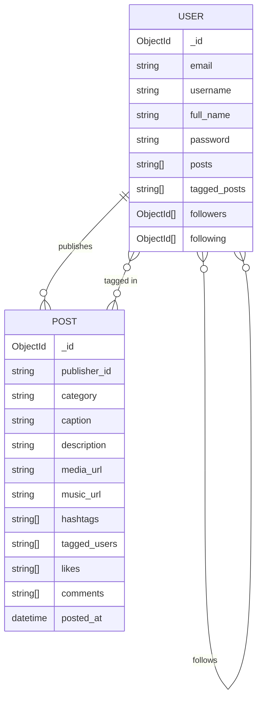

# InstaClone Backend

A RESTful API for a social media platform with user authentication, follow graphs, and post creation — built with FastAPI and MongoDB.

---

## Tech Stack

| Layer | Technology |
|---|---|
| Framework | FastAPI 0.115 |
| Runtime | Python 3 / Uvicorn |
| Database | MongoDB (Motor — async driver) |
| Auth | PyJWT + bcrypt |
| Validation | Pydantic v2 |
| Rate limiting | slowapi (in-memory, per-route) |
| Testing | pytest + pytest-asyncio + httpx (real MongoDB test DB) |
| API Docs | Swagger UI / ReDoc (built-in) |

---

## Key Features

- **JWT authentication** — register and login return a signed token; all protected routes verify it via a FastAPI `Depends` guard
- **bcrypt password hashing** — passwords are never stored or returned in plaintext; the `password` field is stripped from every response
- **Social graph** — follow/unfollow by username or user ID, with atomic `$addToSet` / `$pull` writes to both sides of the relationship
- **Post creation with tagging** — posts resolve tagged usernames to IDs at write time and update each tagged user's `tagged_posts` list
- **Categorised content** — posts are assigned to one of seven categories (Tech, Entertainment, Business, Sports, Music, Art, Education) enforced by an enum
- **Layered validation** — Pydantic validates types at the boundary; custom validators enforce business rules (password complexity, username format, caption/hashtag length, URL scheme)
- **Rate limiting** — slowapi guards write-heavy endpoints (registration, login, post creation, likes) with per-minute limits backed by in-memory storage
- **Privilege escalation prevention** — `UserUpdateRequest` and `PostUpdateRequest` use `extra='forbid'` so unknown fields (e.g. `is_admin`, `posts`, `followers`) are rejected with 422 at the Pydantic boundary; a service-level allowlist provides defence-in-depth

---

## Architecture

```
instaclone-backend/
├── app/
│   ├── main.py                # FastAPI app, router registration, custom OpenAPI schema
│   ├── config/
│   │   └── settings.py        # Reads env vars (MONGO_URI, JWT_SECRET_KEY, JWT_ALGORITHM)
│   ├── models/
│   │   ├── db.py              # Plain-class document models (UserDB, PostDB, CommentDB) + ObjectId serializer
│   │   └── pydantic.py        # Request body schemas (UserCreateRequest, PostCreateRequest, …)
│   ├── routes/
│   │   ├── auth_routes.py     # POST /auth/create, /auth/login, /auth/verify-token
│   │   ├── user_routes.py     # GET/PUT profile, follow/unfollow, followers/following
│   │   └── post_routes.py     # CRUD posts, like/unlike, comments, feed
│   ├── services/
│   │   ├── auth_service.py    # create_user, authenticate_user
│   │   ├── user_service.py    # CRUD + follow graph mutations
│   │   └── post_service.py    # create_post (inserts post, updates publisher + tagged users)
│   └── utils/
│       ├── auth.py            # create_access_token, verify_token, get_current_user (Depends)
│       ├── db.py              # get_database() — returns Motor async client
│       ├── user_validator.py  # validate_email, validate_password, validate_username
│       └── post_validator.py  # validate_caption, validate_hashtags, validate_media_url, …
├── requirements.txt
├── .env.example
└── README.md
```

### Request flow

```
HTTP request
  → FastAPI router (routes/)
    → Input validation (Pydantic model + custom validator utils)
      → Auth guard: get_current_user Depends (utils/auth.py)
        → Service layer (services/)
          → Motor async query (utils/db.py → MongoDB)
            → Serialize ObjectIds (models/db.py serialize_document)
              → JSON response
```

---

## Design Decisions

- **JWT with per-token salt** — `create_access_token` mixes a random 60-byte salt into each token payload. This means two logins with identical data produce different tokens, preventing simple replay, though tokens cannot be individually revoked (no blocklist).
- **bcrypt for password storage** — passwords are hashed with `bcrypt.gensalt()` at registration. The raw password is never persisted or returned; routes that return user documents call `user.pop("password")` before sending the response.
- **Motor for async I/O** — FastAPI is async-native; Motor provides non-blocking MongoDB calls that fit naturally into `async def` route handlers without thread-pool overhead.
- **Two-layer validation** — Pydantic handles type coercion and `EmailStr` format checks at the HTTP boundary; a separate `utils/validators` layer enforces domain rules (password complexity, username character set, max hashtag count) so business logic stays out of Pydantic models.

---

## API Reference

### Auth

| Method | Endpoint | Auth | Description |
|---|---|---|---|
| POST | `/auth/create` | No | Register a new user; returns user info + access token |
| POST | `/auth/login` | No | Authenticate with email + password; returns access token |
| POST | `/auth/verify-token` | No | Validate a JWT; returns user_id on success |
| POST | `/auth/refresh` | Bearer | Issue a new token from a valid existing token; no credentials required |

### Users

| Method | Endpoint | Auth | Description |
|---|---|---|---|
| GET | `/users/me` | Bearer | Get the current user's own profile |
| GET | `/users/get-by-email` | Bearer | Look up a user by email address |
| GET | `/users/profile/{username}` | No | Get public profile by username |
| PUT | `/users/profile/update` | Bearer | Update own profile fields (partial update) |
| POST | `/users/follow/{username}` | Bearer | Follow a user by username |
| POST | `/users/unfollow/{username}` | Bearer | Unfollow a user by username |
| GET | `/users/{user_id}/followers` | No | List a user's followers (paginated) |
| GET | `/users/{user_id}/following` | No | List users a user follows (paginated) |

### Posts

| Method | Endpoint | Auth | Description |
|---|---|---|---|
| POST | `/posts/` | Bearer | Create a new post (resolves tagged usernames to IDs) |
| GET | `/posts/` | No | List posts, newest first; optional `?category=` filter; paginated |
| GET | `/posts/feed` | Bearer | Personal feed: posts from users you follow, newest first; paginated |
| GET | `/posts/{post_id}` | No | Get a single post by ID |
| PUT | `/posts/{post_id}` | Bearer | Edit own post's caption, description, or hashtags |
| DELETE | `/posts/{post_id}` | Bearer | Delete own post; removes from publisher and tagged users |
| POST | `/posts/{post_id}/like` | Bearer | Like a post |
| DELETE | `/posts/{post_id}/like` | Bearer | Remove like from a post |
| POST | `/posts/{post_id}/comments` | Bearer | Add a comment (embedded in post document) |
| GET | `/posts/{post_id}/comments` | No | Paginated list of comments for a post |

---

## Data Model

### Collections

**`users`**

| Field | Type | Notes |
|---|---|---|
| `_id` | ObjectId | MongoDB primary key |
| `email` | string | unique |
| `username` | string | unique, 3–30 chars, `[A-Za-z0-9_-]` |
| `full_name` | string | max 100 chars |
| `password` | string | bcrypt hash |
| `posts` | string[] | post IDs published by this user |
| `tagged_posts` | string[] | post IDs where this user is tagged |
| `followers` | ObjectId[] | users following this user |
| `following` | ObjectId[] | users this user follows |

**`posts`**

| Field | Type | Notes |
|---|---|---|
| `_id` | ObjectId | MongoDB primary key |
| `publisher_id` | string | `_id` of the creating user |
| `category` | enum | Tech \| Entertainment \| Business \| Sports \| Music \| Art \| Education |
| `caption` | string | max 100 chars |
| `description` | string | max 500 chars |
| `media_url` | string | must start with `http://` or `https://` |
| `music_url` | string? | optional, same URL scheme constraint |
| `hashtags` | string[] | max 10 tags, each max 20 chars |
| `tagged_users` | string[] | resolved from usernames to user `_id`s |
| `likes` | string[] | user IDs of users who liked the post |
| `comments` | object[] | embedded comment records `{user_id, text, commented_at}` |
| `posted_at` | datetime | set server-side at creation |

### Entity Relationships



---

## Getting Started

### Prerequisites

- Python 3.10+
- A MongoDB Atlas cluster (or local MongoDB instance)

### Install

```sh
git clone https://github.com/yourusername/instaclone-backend.git
cd instaclone-backend
python3 -m venv env
source env/bin/activate      # Windows: env\Scripts\activate
pip install -r requirements.txt
```

### Configure environment

```sh
cp .env.example .env
# Edit .env — fill in MONGO_URI, JWT_SECRET_KEY, JWT_ALGORITHM
```

See `.env.example` for the required variables. No migrations are needed; MongoDB creates collections on first write.

### Run

```sh
uvicorn app.main:app --reload
```

The API is available at `http://127.0.0.1:8000`.

---

## Testing and API Docs

### Interactive API docs

| UI | URL |
|---|---|
| Swagger UI | `http://127.0.0.1:8000/docs` |
| ReDoc | `http://127.0.0.1:8000/redoc` |

All endpoints require a Bearer token in Swagger — click **Authorize** and paste the token returned by `/auth/login` or `/auth/create`.

### Tests

Tests use a real MongoDB instance pointed at the `instaclone_test` database (isolated from the dev database). Each test run drops `users` and `posts` collections before the test via a fixture, and rate limiter state is reset between tests.

```sh
# Requires a running MongoDB instance (default: localhost:27017)
python -m pytest tests/
```

The suite has 193 tests across six files:

| File | Coverage |
|---|---|
| `tests/test_auth.py` | Registration, login, token verification — happy paths |
| `tests/test_auth_edge_cases.py` | Password/username/full-name boundaries, JWT security (tampered, expired, missing claims), header format variants, token refresh |
| `tests/test_posts.py` | Post CRUD, likes, comments, feed — happy paths |
| `tests/test_posts_edge_cases.py` | Caption/description/hashtag boundaries, URL scheme, category enum, pagination slicing, post edit, comment pagination |
| `tests/test_users.py` | Profile update, follow graph, paginated follower/following lists — happy paths |
| `tests/test_users_edge_cases.py` | Field validation boundaries, follow/unfollow cycles, mutual follow, sensitive field exclusion, field injection prevention |

---

## Future Improvements

- **Comment storage migration** — comments are embedded in the post document and paginated in-memory by the service. At scale (thousands of comments per post) a dedicated `comments` collection with a `post_id` index and server-side cursor-based pagination would be more efficient.
- **Token revocation** — `POST /auth/refresh` issues a fresh token but there is no blocklist; a compromised token remains valid until expiry. A Redis-backed token blocklist or a short-lived access + long-lived refresh token pair would plug this gap.
- **Distributed rate limiting** — the current slowapi setup uses in-memory storage, which resets on process restart and does not work across multiple workers. Switching to a Redis backend would give persistent, cross-process limits.
